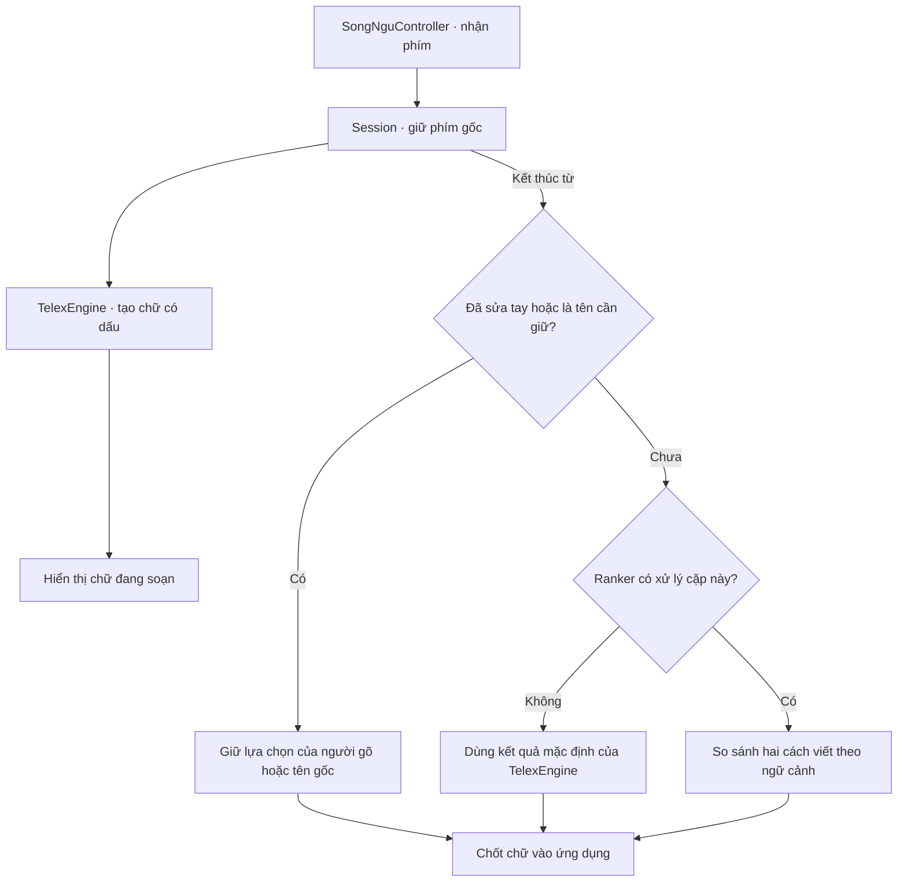

# SongNgu

Bộ gõ Telex song ngữ cho macOS Apple Silicon. SongNgu sử dụng ngữ cảnh khi chọn giữa chuỗi phím gốc và kết quả Telex. Dữ liệu mô hình chạy trên máy đã có trong Resources.

## Kiến trúc bộ gõ

Mỗi lần nhấn phím, `SongNguController` nhận sự kiện từ InputMethodKit. `Session` giữ chuỗi phím gốc và dùng `TelexEngine` để cập nhật chữ đang hiện trong ứng dụng. Khi gặp ranh giới từ, bộ gõ chọn cách viết theo luồng dưới đây.

Ví dụ, chuỗi `gif` có thể cho ra **gif** trong “gửi mình file gif nhé” hoặc **gì** trong “bạn gửi mình file gì vậy?”. Khi ứng dụng hỗ trợ và người dùng vừa gõ dấu cách, `Session` có thể giữ từ nhập nhằng trong vùng đang soạn thêm một từ để xét ngữ cảnh bên phải trước khi chốt. Lựa chọn sửa tay được ưu tiên khi xét lại.

Bản macOS mặc định dùng bảng n-gram cục bộ cho các cặp được hỗ trợ. Hai cặp `gif/gì` và `max/mã` dùng bộ chọn riêng. XLM-R chỉ tham gia các thí nghiệm huấn luyện. [Luồng nhập liệu](App/main.swift) · [Trạng thái phiên gõ](Core/Session.swift) · [Bộ chọn từ](Core/Context.swift)

## Build và kiểm thử

Trên Mac có Xcode Command Line Tools, chạy `./test.sh` và `./build.sh`. Kết quả nằm ở `build/SongNgu.app`.

Để tạo thư mục cập nhật, chép `Packaging/Update.command` vào `build/` và chạy `clang -mmacosx-version-min=13.0 -framework Carbon Packaging/activate.c -o build/activate`. Bản build dùng chữ ký ad hoc.

## Cập nhật VietTelex

Các tệp Swift trong TelexCore được lấy nguyên bản từ [ptrinh/VietTelex](https://github.com/ptrinh/VietTelex/tree/b9cf90de6df42438b80b5e3d7d2c00669c1bf1de/TelexCore/Sources/TelexCore) tại commit `b9cf90de6df42438b80b5e3d7d2c00669c1bf1de`. Khi nâng phiên bản, so sánh thư mục upstream đó với TelexCore, rà soát ghi công và chạy lại bộ kiểm thử. Mã chọn từ của SongNgu nằm ở Core.

Xem TelexCore/LICENSE, TelexCore/DATA-SOURCES.md và Notices/ cho mã và dữ liệu bên thứ ba. Các script huấn luyện thử nghiệm trong Tools sử dụng dữ liệu UD r2.15 ở ../data và checkpoint XLM-R ở ../xlmr. Các dữ liệu đầu vào này chỉ cần khi huấn luyện lại.
