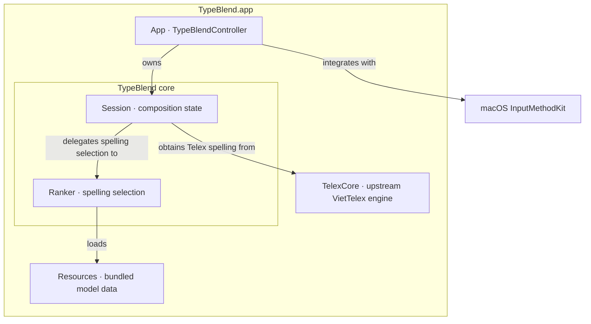

# TypeBlend

TypeBlend is a Vietnamese–English Telex input method for Apple Silicon Macs. It lets you type both languages in the same sentence. When a sequence such as `gif` could mean either the English file format or the Vietnamese word *gì*, TypeBlend uses nearby words to choose a spelling. All typing and scoring stay on your Mac.

## Bilingual typing shortcuts

- Press **Control + ;** to switch the spelling of the current word (for example, `gif` ↔ `gì`). You can also switch the last word immediately after a space or punctuation. For committed text, the editor must report the same caret and text before TypeBlend will replace it.
- Press **Control + Option + ;** while typing a name, or immediately after it, to keep its original spelling on this Mac. Capitalization follows your keystrokes.
- Two consistent manual corrections in the same preceding word context teach a local preference. TypeBlend stores the spelling choice and up to two preceding words in macOS preferences. The English phrase list also recognizes mixed-language expressions such as `out of office`. All lookups run on device.

## Install or update

On an Apple Silicon Mac running macOS 13 or later, open the [latest TypeBlend.pkg](https://github.com/sonmai/TypeBlend/releases/latest/download/TypeBlend.pkg) and install it for your user account. The installer upgrades the existing `~/Library/Input Methods/TypeBlend.app` in place. Sign out and back in to load the new build. On first install, add TypeBlend under System Settings → Keyboard → Input Sources → Vietnamese.

The community installer is unsigned and has not been notarized by Apple. If macOS blocks the downloaded installer because the developer cannot be verified, first confirm it came from this repository’s Releases page. To approve this installer, open System Settings → Privacy & Security → Open Anyway. [Apple’s instructions](https://support.apple.com/en-au/102445)

## Release

Every push to `main`, including a merged pull request, triggers a release. GitHub Actions selects the next patch after the highest stable version tag. It runs the tests, installs the package over the existing per-user app, verifies the bundle, and publishes `TypeBlend.pkg` and its SHA-256 checksum. A rerun reuses the tag on the same commit. To select a specific version manually, push a `vMAJOR.MINOR.PATCH` tag. This community release requires no Apple Developer Program membership or signing secrets.

To reproduce the package locally, run `./Packaging/package.sh 0.2.8`. The output is `build/TypeBlend.pkg`.

## Architecture

### System overview

TypeBlend runs as a macOS input source. Applications such as Notes and Word communicate with it through InputMethodKit. The app bundles the Telex engine and the model data it needs for typing.

### Components inside TypeBlend.app

Each arrow points from a component to a dependency it uses.



`TypeBlendController` inserts ordinary text in every application so that the current word has no composition underline. Before revising a spelling, it checks that the caret and previously inserted text still match. When the field cannot report a usable caret or return the previous text, TypeBlend composes new input internally and inserts the word as plain text at the next boundary. `Session` tracks the original keystrokes, the word being composed, nearby words and manual corrections. The replay tests exercise this same session logic one keystroke at a time. [macOS integration](App/main.swift) · [Session state](Core/Session.swift) · [Replay tests](Tests/main.swift)

### Spelling selection and model data

The ranker receives the raw keystrokes, the Telex spelling and the available context. The default build uses the following resources.

| Component | Bundled data | Responsibility |
|---|---|---|
| Supported spelling pairs | `collisions.txt` and entries in `model.json` | Identify keystroke sequences eligible for contextual scoring. |
| N-gram scorer | `ng.bin`, `ng-tags.bin` | Look up scores for nearby word combinations and verify the lookup tags. Use the Telex engine’s default spelling when the evidence is weak. |
| SeedRanker | `model.json` | Score the two pairs `gif/gì` and `max/mã` with a dedicated model. |

The Python tools generate model data offline. XLM-R is used during experimental training. The shipping input method uses the bundled resources listed above. [Ranker](Core/Context.swift) · [SeedRanker](Core/Ranker.swift) · [Training](Tools/fit_context.py) · [Build script](build.sh)

## Build and test

On an Apple Silicon Mac with Xcode Command Line Tools installed, run these commands from the repository root.

```sh
./test.sh
./build.sh
```

The build produces an ad hoc signed app at `build/TypeBlend.app`. To include the updater and input-source activation helper in the same directory, run:

```sh
cp Packaging/Update.command build/
clang -mmacosx-version-min=13.0 -framework Carbon Packaging/activate.c -o build/activate
```

## Updating the VietTelex engine

The Swift sources in `TelexCore/` come from VietTelex commit `b9cf90de6df42438b80b5e3d7d2c00669c1bf1de`. When updating the engine, compare the upstream sources with the local copy, review the attribution notices and rerun the tests. TypeBlend’s contextual spelling logic lives in `Core/`. [Pinned upstream sources](https://github.com/ptrinh/VietTelex/tree/b9cf90de6df42438b80b5e3d7d2c00669c1bf1de/TelexCore/Sources/TelexCore) · [Engine license](TelexCore/LICENSE) · [Data sources](TelexCore/DATA-SOURCES.md) · [Third-party notices](Notices/)

To retrain the experimental models, the scripts in `Tools/` expect Universal Dependencies r2.15 data in `../data` and an XLM-R checkpoint in `../xlmr`. Building the input method uses the model files already in the repository.

## License

TypeBlend's original code is licensed under the [MIT License](LICENSE). The bundled VietTelex engine includes its [upstream MIT license](TelexCore/LICENSE) and [data attributions](TelexCore/DATA-SOURCES.md). The model tables `ng.bin` and `student.bin` are distributed under CC BY-SA 4.0. See the [third-party notices](Notices/SOURCES.txt) for details.
