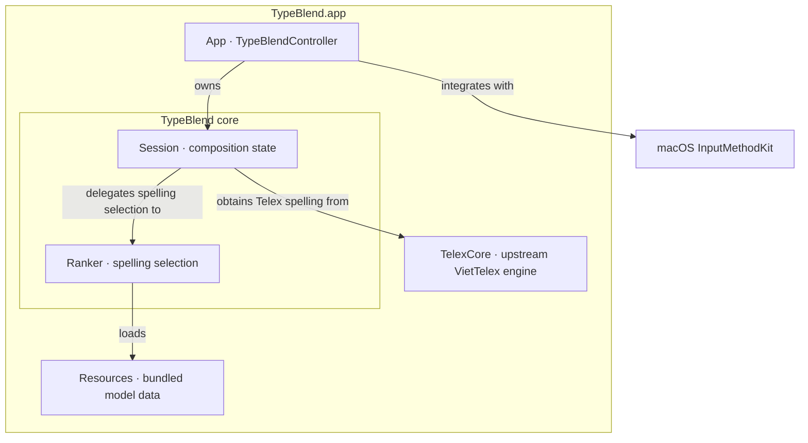

# TypeBlend

TypeBlend is a Vietnamese–English Telex input method for Apple Silicon Macs. It lets you type both languages in the same sentence. When a sequence such as `gif` could mean either the English file format or the Vietnamese word *gì*, TypeBlend uses nearby words to choose a spelling. All typing and scoring stay on your Mac.

## Architecture

### System overview

TypeBlend runs as a macOS input source. Applications such as Notes and Word communicate with it through InputMethodKit. The app bundles the Telex engine and the model data it needs for typing.

### Components inside TypeBlend.app

Each arrow points from a component to a dependency it uses.



`TypeBlendController` displays marked text and commits the final spelling to the host application. `Session` tracks the original keystrokes, the word being composed, nearby words and manual corrections. The replay tests exercise this same session logic one keystroke at a time. [macOS integration](App/main.swift) · [Session state](Core/Session.swift) · [Replay tests](Tests/main.swift)

### Spelling selection and model data

The ranker receives the raw keystrokes, the Telex spelling and the available context. The default build uses the following resources.

| Component | Bundled data | Responsibility |
|---|---|---|
| Supported spelling pairs | `collisions.txt` and entries in `model.json` | Identify keystroke sequences eligible for contextual scoring. |
| N-gram scorer | `ng.bin`, `ng-tags.bin` | Look up scores for nearby word combinations and verify the lookup tags. Use the Telex engine’s default spelling when the evidence is weak. |
| SeedRanker | `model.json` | Score the two pairs `gif/gì` and `max/mã` with a dedicated model. |

The Python tools generate model data offline. XLM-R is used during experimental training. The shipping input method uses the bundled resources listed above. [Ranker](Core/Context.swift) · [SeedRanker](Core/Ranker.swift) · [Training](Tools/fit_context.py) · [Build script](build.sh)

## Build and test

On an Apple Silicon Mac with Xcode Command Line Tools installed, run these commands from the repository root.

```sh
./test.sh
./build.sh
```

The build produces an ad hoc signed app at `build/TypeBlend.app`. To include the updater and input-source activation helper in the same directory, run:

```sh
cp Packaging/Update.command build/
clang -mmacosx-version-min=13.0 -framework Carbon Packaging/activate.c -o build/activate
```

## Updating the VietTelex engine

The Swift sources in `TelexCore/` come from VietTelex commit `b9cf90de6df42438b80b5e3d7d2c00669c1bf1de`. When updating the engine, compare the upstream sources with the local copy, review the attribution notices and rerun the tests. TypeBlend’s contextual spelling logic lives in `Core/`. [Pinned upstream sources](https://github.com/ptrinh/VietTelex/tree/b9cf90de6df42438b80b5e3d7d2c00669c1bf1de/TelexCore/Sources/TelexCore) · [Engine license](TelexCore/LICENSE) · [Data sources](TelexCore/DATA-SOURCES.md) · [Third-party notices](Notices/)

To retrain the experimental models, the scripts in `Tools/` expect Universal Dependencies r2.15 data in `../data` and an XLM-R checkpoint in `../xlmr`. Building the input method uses the model files already in the repository.
