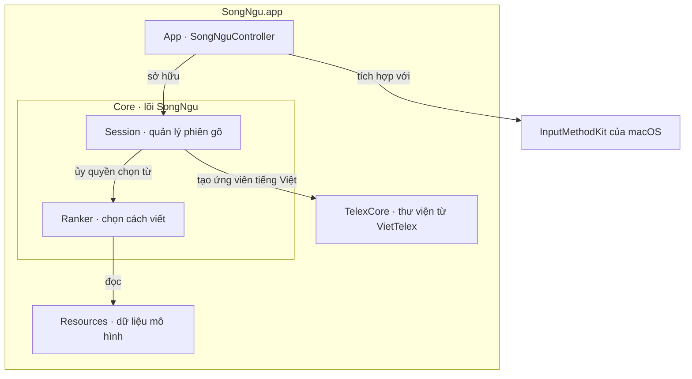

# SongNgu

Bộ gõ Telex song ngữ cho macOS Apple Silicon. SongNgu sử dụng ngữ cảnh khi chọn giữa chuỗi phím gốc và kết quả Telex. Dữ liệu mô hình chạy trên máy đã có trong Resources.

## Kiến trúc bộ gõ

### Tổng quan hệ thống

SongNgu là bộ gõ chạy cục bộ trên Mac. Người dùng chọn SongNgu làm nguồn nhập của macOS và tiếp tục soạn thảo trong ứng dụng như Notes hoặc Word. macOS kết nối ô nhập liệu với bộ gõ qua InputMethodKit. SongNgu sở hữu phần xử lý Telex và chọn cách viết Anh–Việt theo ngữ cảnh. Dữ liệu cần để gõ nằm sẵn trong `SongNgu.app`.

### Các thành phần bên trong SongNgu.app

Các mũi tên biểu thị quan hệ phụ thuộc giữa các thành phần.

`SongNguController` chịu trách nhiệm hiển thị chữ đang soạn và chèn chữ đã chốt vào ứng dụng. `Session` giữ chuỗi phím gốc, từ đang soạn, ngữ cảnh và lựa chọn sửa tay. Nhờ ranh giới này, có thể kiểm thử cùng một lõi chọn từ bằng cách phát lại chuỗi phím mà không phải mở Notes. [Tích hợp macOS](App/main.swift) · [Phiên gõ](Core/Session.swift) · [Kiểm thử phát lại](Tests/main.swift)

### Chi tiết bộ chọn từ và dữ liệu mô hình

`Ranker` nhận chuỗi phím gốc, kết quả Telex và các từ lân cận từ `Session`. Bản phát hành mặc định sử dụng các thành phần sau.

| Thành phần | Dữ liệu đóng gói | Trách nhiệm |
|---|---|---|
| Danh sách cặp nhập nhằng | `collisions.txt` và danh sách trong `model.json` | Xác định những chuỗi phím mà bộ chọn hỗ trợ. |
| Bộ chấm điểm n-gram trong `Ranker` | `ng.bin`, `ng-tags.bin` | Tra điểm của các cụm từ lân cận và kiểm tra dấu nhận dạng của mục tra cứu. Khi bằng chứng yếu, dùng kết quả mặc định của lõi Telex. |
| `SeedRanker` | `model.json` | Chấm điểm riêng cho hai cặp `gif/gì` và `max/mã`. |

Các công cụ Python trong `Tools/` tạo dữ liệu cho bản build. XLM-R được dùng để huấn luyện mô hình thử nghiệm trên máy phát triển. Bộ gõ phát hành chỉ nạp các tài nguyên cục bộ liệt kê ở trên. [Ranker](Core/Context.swift) · [SeedRanker](Core/Ranker.swift) · [Huấn luyện](Tools/fit_context.py) · [Đóng gói](build.sh)

## Build và kiểm thử

Trên Mac có Xcode Command Line Tools, chạy `./test.sh` và `./build.sh`. Kết quả nằm ở `build/SongNgu.app`.

Để tạo thư mục cập nhật, chép `Packaging/Update.command` vào `build/` và chạy `clang -mmacosx-version-min=13.0 -framework Carbon Packaging/activate.c -o build/activate`. Bản build dùng chữ ký ad hoc.

## Cập nhật VietTelex

Các tệp Swift trong TelexCore được lấy nguyên bản từ [ptrinh/VietTelex](https://github.com/ptrinh/VietTelex/tree/b9cf90de6df42438b80b5e3d7d2c00669c1bf1de/TelexCore/Sources/TelexCore) tại commit `b9cf90de6df42438b80b5e3d7d2c00669c1bf1de`. Khi nâng phiên bản, so sánh thư mục upstream đó với TelexCore, rà soát ghi công và chạy lại bộ kiểm thử. Mã chọn từ của SongNgu nằm ở Core.

Xem TelexCore/LICENSE, TelexCore/DATA-SOURCES.md và Notices/ cho mã và dữ liệu bên thứ ba. Các script huấn luyện thử nghiệm trong Tools sử dụng dữ liệu UD r2.15 ở ../data và checkpoint XLM-R ở ../xlmr. Các dữ liệu đầu vào này chỉ cần khi huấn luyện lại.
