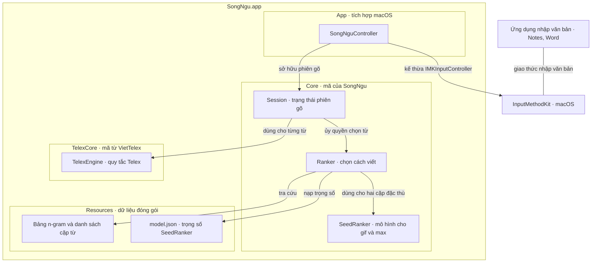

# SongNgu

Bộ gõ Telex song ngữ cho macOS Apple Silicon. SongNgu sử dụng ngữ cảnh khi chọn giữa chuỗi phím gốc và kết quả Telex. Dữ liệu mô hình chạy trên máy đã có trong Resources.

## Kiến trúc bộ gõ

SongNgu chạy trên Mac dưới dạng một ứng dụng bộ gõ dùng InputMethodKit. Sơ đồ thể hiện các thành phần của bản phát hành mặc định. Mũi tên hướng từ thành phần sử dụng đến thành phần mà nó phụ thuộc.

- **Tích hợp macOS.** `SongNguController` quản lý giao tiếp với ô nhập liệu qua `IMKTextInput`. Phần hiển thị chữ đang soạn và chèn chữ đã chốt thuộc lớp này. [App/main.swift](App/main.swift)
- **Lõi SongNgu.** `Session` sở hữu chuỗi phím gốc, lịch sử ngữ cảnh và lựa chọn sửa tay. Mỗi từ đang soạn có một `TelexEngine` để tạo cách viết tiếng Việt. `Ranker` nhận các cách viết và ngữ cảnh để chấm điểm, độc lập với API nhập liệu của macOS. [Session.swift](Core/Session.swift) · [Context.swift](Core/Context.swift) · [Ranker.swift](Core/Ranker.swift)
- **Huấn luyện ngoại tuyến.** Các công cụ trong `Tools/` tạo dữ liệu mô hình. Bản macOS mặc định đóng gói bảng n-gram, danh sách cặp từ và trọng số của `SeedRanker`. XLM-R chỉ dùng trong thí nghiệm huấn luyện. [Công cụ huấn luyện](Tools/fit_context.py) · [Cấu hình đóng gói](build.sh)

## Build và kiểm thử

Trên Mac có Xcode Command Line Tools, chạy `./test.sh` và `./build.sh`. Kết quả nằm ở `build/SongNgu.app`.

Để tạo thư mục cập nhật, chép `Packaging/Update.command` vào `build/` và chạy `clang -mmacosx-version-min=13.0 -framework Carbon Packaging/activate.c -o build/activate`. Bản build dùng chữ ký ad hoc.

## Cập nhật VietTelex

Các tệp Swift trong TelexCore được lấy nguyên bản từ [ptrinh/VietTelex](https://github.com/ptrinh/VietTelex/tree/b9cf90de6df42438b80b5e3d7d2c00669c1bf1de/TelexCore/Sources/TelexCore) tại commit `b9cf90de6df42438b80b5e3d7d2c00669c1bf1de`. Khi nâng phiên bản, so sánh thư mục upstream đó với TelexCore, rà soát ghi công và chạy lại bộ kiểm thử. Mã chọn từ của SongNgu nằm ở Core.

Xem TelexCore/LICENSE, TelexCore/DATA-SOURCES.md và Notices/ cho mã và dữ liệu bên thứ ba. Các script huấn luyện thử nghiệm trong Tools sử dụng dữ liệu UD r2.15 ở ../data và checkpoint XLM-R ở ../xlmr. Các dữ liệu đầu vào này chỉ cần khi huấn luyện lại.
